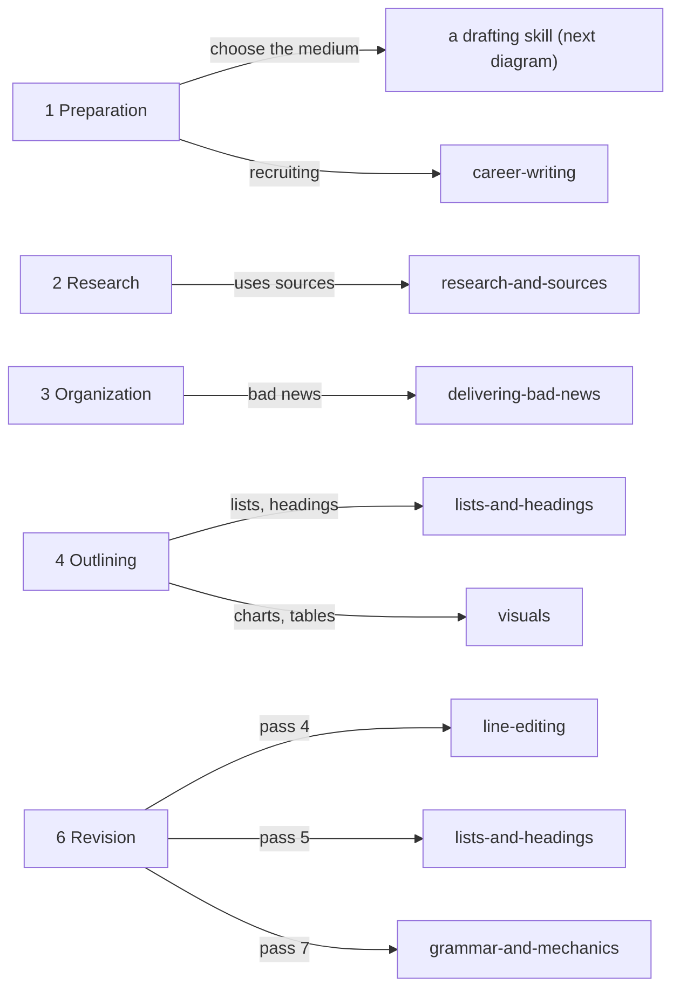
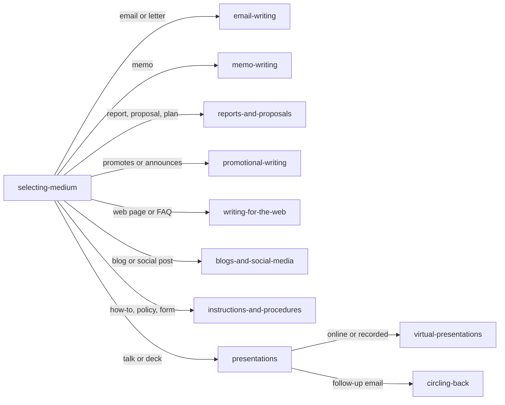

# Business Writing Skills for AI Agents

**A family of 19 agent skills that make an AI assistant write business documents the way a
careful professional does: purpose and audience first, facts verified, the right format
for the medium, and several revision passes before anything is delivered.** It works in
[Claude Code](https://code.claude.com/docs/en/skills) and in the Hermes agent,
and it ships with 18 fill-in templates drawn from openly licensed and public-domain sources.

Ask for a memo, and it first checks whether a memo is the right call. Ask for a rejection
letter, and it puts the reasons before the no.

---

## What it does

One entry skill, `business-writing`, runs a six-step sequence and loads a specialist skill
only at the step that needs it:

1. **Preparation:** purpose, audience, scope, and medium, then two gates:
   - **Premise check:** every claim about an offer, a decision, or a deadline is marked
     confirmed, inferred, or assumed, and anything unconfirmed is cut, asked about, or
     anchored rather than stated as fact.
   - **Context gate:** if a missing fact would change the draft, the assistant asks once
     instead of writing around the gap.
2. **Research**, with source evaluation and citation.
3. **Organization**, including the right pattern for bad news.
4. **Outlining**, with lists, headings, and visuals planned.
5. **Writing.**
6. **Revision** in separate passes: structure, a "wrong-premise" reread, the 8 S's,
   line editing, formatting, constraints, and proofreading.

Every drafting skill carries an **entry-and-exit rule**: if a request starts there ("write
a press release"), it first runs the preparation steps and, when the draft is done, hands
back for revision. No route skips the checks.

### The routing tree

Each step of the sequence loads its specialists:



At step 1.4, the medium decides which drafting skill takes over:



---

## A worked example: writing this README

This README was written with the family itself. The skill-load log from that session:

| Step | Skill loaded | What it decided |
| --- | --- | --- |
| 1.1–1.3 | `business-writing` | Purpose: a reader understands the project in two minutes, and an installer is running in five. Two audiences, weighted equally. |
| 1.4 | `writing-for-the-web` | A GitHub page is a web page: main point first, scannable headings, keywords in the opening lines, links to specific pages rather than homepages. |
| 1.5 | `business-writing` (premise check) | Every number below comes from a check that was run; nothing is estimated. |
| 6, pass 4 | `line-editing` | Cut wordy phrases and hedges; active voice. |
| 6, pass 5 | `lists-and-headings` | Parallel list items; headings that say what the section holds. |
| 6, pass 7 | `grammar-and-mechanics` | Proofread, with numbers checked against their sources. |

The same chain runs for any request. Asked for a press release, the agent loads
`promotional-writing`, which sends it back to `business-writing` for preparation, then on
to `line-editing` and `grammar-and-mechanics` before delivery. That route was confirmed in
an end-to-end test on the private edition, whose routing this edition keeps unchanged (see
[METHOD.md](METHOD.md)).

---

## The 19 skills

| Skill | Use it for |
| --- | --- |
| `business-writing` | The entry point: the sequence, the two gates, the 8 S's, and delivery |
| `selecting-medium` | Email, call, memo, or meeting? Six factors and two governing rules |
| `email-writing` | Subject lines, requests, follow-ups, thread replies, business letters |
| `memo-writing` | Memos and report memos (investigative, feasibility, progress, incident) |
| `reports-and-proposals` | Formal reports, executive summaries, proposals, RFPs, business plans |
| `delivering-bad-news` | The indirect pattern for customers, the upward pattern for your boss |
| `promotional-writing` | Press releases, sales letters, newsletters, with finance-marketing rules |
| `writing-for-the-web` | Web pages, FAQs, repurposing, accessibility |
| `blogs-and-social-media` | Posts, forums, platform choice, disclosure rules |
| `instructions-and-procedures` | Instructions, SOPs, policies, forms, job descriptions |
| `presentations` | Purpose, structure, slide design, rehearsal, delivery, meetings |
| `virtual-presentations` | Camera, sound, and engagement for online and recorded talks |
| `circling-back` | The follow-up email after a talk: action, owner, date |
| `career-writing` | Résumés, cover letters, STAR stories, offers |
| `research-and-sources` | Evaluating, quoting, paraphrasing, and citing sources |
| `visuals` | Choosing and building charts and tables; misleading scales |
| `lists-and-headings` | List and heading rules; page design |
| `line-editing` | Wordiness, voice, parallel structure, plain language |
| `grammar-and-mechanics` | Proofreading, punctuation, numbers, confused words |

Finance gets particular attention throughout: investment-memo order, financial-number
conventions, Reg FD and safe-harbor rules for promotion, chart conventions, and SOPs as
internal-control records.

## The 18 templates

Each template states its source and license in its own header. Details are in
[ATTRIBUTION.md](ATTRIBUTION.md).

| Template | Skill | Source |
| --- | --- | --- |
| Memo (and report-memo variant) | `memo-writing` | Adapted from Last, *Technical Writing Essentials* (CC BY 4.0) |
| Executive summary | `reports-and-proposals` | Adapted from Last (CC BY 4.0) |
| Formal report outline | `reports-and-proposals` | Adapted from Last (CC BY 4.0) |
| Internal proposal | `reports-and-proposals` | Adapted from Last (CC BY 4.0) |
| Progress report | `reports-and-proposals` | Adapted from Last (CC BY 4.0) |
| RFP response | `reports-and-proposals` | Original |
| Incident report | `reports-and-proposals` | Original |
| Standard operating procedure | `instructions-and-procedures` | Adapted from US EPA, *Guidance for Preparing SOPs* (public domain) |
| Job description | `instructions-and-procedures` | Original |
| Agenda and minutes | `presentations` | Adapted from *Robert's Rules of Order* (1876, public domain) |
| Request email and follow-up | `email-writing` | Original |
| Full-block business letter | `email-writing` | Original |
| Indirect bad-news letter | `delivering-bad-news` | Original |
| Complaint response (adjustment) | `delivering-bad-news` | Original |
| Press release | `promotional-writing` | Original |
| Sales letter | `promotional-writing` | Original |
| FAQ page | `writing-for-the-web` | Original |
| One-page finance résumé and cover letter | `career-writing` | Original |

The sourcing rule: adopt a credible, openly licensed template when one fits the family's
principles; otherwise write one, and cite what it is consistent with. Plain-language rules
come from two public-domain US government guides: the SEC's *A Plain English Handbook* and
the federal plain-language guidelines.

---

## Install

**Claude Code**

```bash
git clone https://github.com/sapmb20/business-writing-skills.git
cd business-writing-skills
scripts/install-claude.sh          # symlinks each skill into ~/.claude/skills
```

Then ask for any business document; `business-writing` loads on its own, or call it with
`/business-writing`. To install somewhere else, set `CLAUDE_SKILLS_DIR`.

**Hermes**

```bash
HERMES_HOST=<your-ssh-host> scripts/deploy-hermes.sh
```

The script builds each skill from the committed HEAD with its frontmatter from `hermes/`,
backs up any existing copies on the host, installs them, and lints every skill. Optional:
`HERMES_CATEGORY` (default `productivity`) and `HERMES_AGENT_DIR`.

---

## How it was verified

The family was first built against a commercial business-writing textbook and checked line
by line: 392 entries, 5,734 rule units (94.6% matched by script, the rest triaged by hand),
and 2,704 index sub-entries. That edition stays private, because its reference material
follows the textbook closely.

The framework is original and appears here in full: splitting the work into 19 skills, the
routing tree that loads each one at the step that needs it, the premise check and context
gate, the wrong-premise revision pass, the entry-and-exit rule, and the verification
tooling. None of it came from the textbook or the course. The underlying writing steps
(prepare, research, organize, write, revise) are standard practice; the book-derived
reference content was replaced with original writing and openly licensed sources.

Checks run on this edition before publishing:

- **Every request reaches the right skill.** A workflow audit confirms all 19 skills are
  reachable from the entry skill, every one routes back for revision, and no reference file
  is orphaned. 0 failures.
- **Safe to fork and adapt.** A copy check found no passage of 8 or more words shared with
  the textbook, and every adopted source's license was verified on its live page, so you
  can reuse this under the licenses below.
- **No personal or course material**, in any file or anywhere in the commit history.

The tools and the full recipe are in [METHOD.md](METHOD.md) and [`tools/`](tools/), so you
can run the same checks on your own skill family.

---

## License and provenance

- **Code** (`scripts/`, `tools/`): [MIT](LICENSE).
- **Skill text and original templates:** [CC BY 4.0](LICENSE-CONTENT).
- **Adopted material** keeps its own license (CC BY 4.0 or public domain), stated in each
  file and in [ATTRIBUTION.md](ATTRIBUTION.md).

Written by [sapmb20](https://github.com/sapmb20) with Claude. The skills were developed
while studying business communication in a university course and a commercial textbook;
neither one's content is included here.
